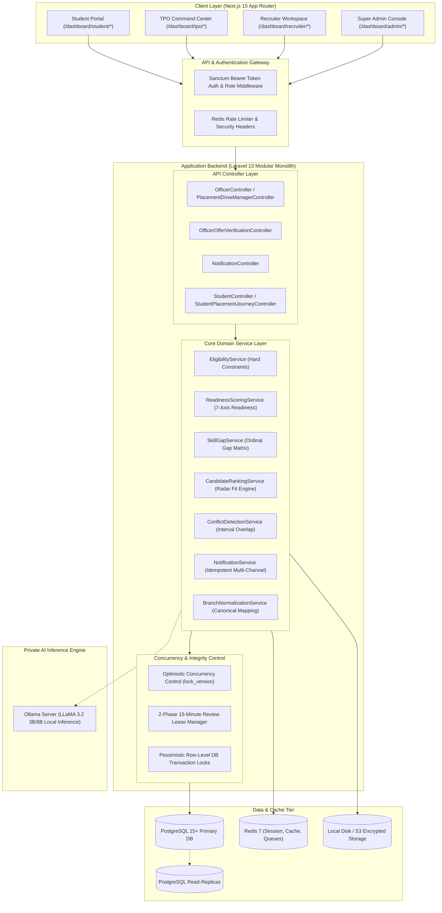
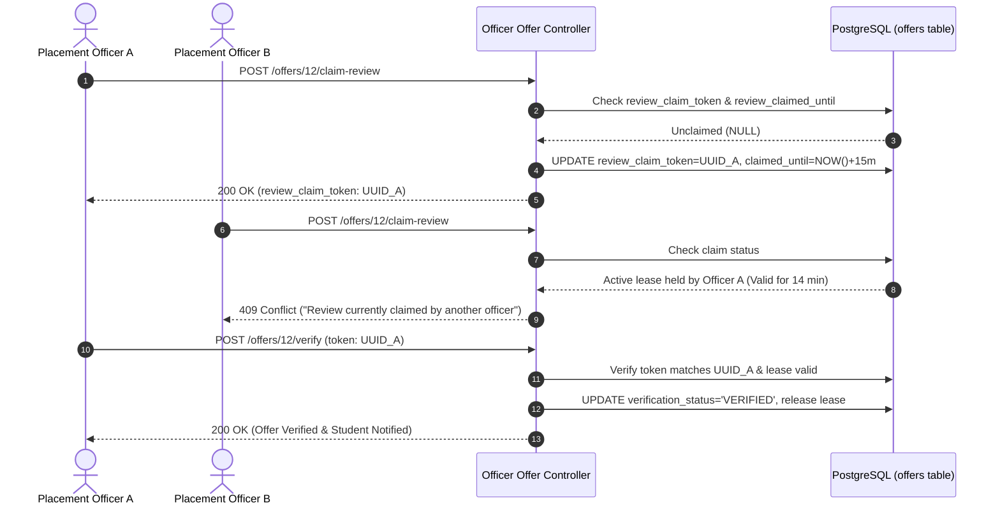

# CAMPUSLINK System Architecture

## 1. Executive Architecture Overview

CAMPUSLINK is an enterprise AI-powered Campus-to-Corporate Placement Management, Analytics, and Scheduling Platform. The system is designed as a high-performance **Modular Monolith** pairing a **Next.js 15 (React 19)** App Router frontend with a **Laravel 13 (PHP 8.2+)** RESTful backend, backed by **PostgreSQL 15+**, **Redis 7**, and **Ollama (LLaMA 3.2)** for local private LLM justification inference.

---

## 2. Technology Stack & Runtime Specifications

| Layer | Technology | Version | Key Purpose |
| :--- | :--- | :--- | :--- |
| **Frontend** | Next.js (App Router) | `15.0+` | Server and client rendered UI, layout segregation, route guards |
| **Frontend Language** | TypeScript | `5.6+` | Strict static typing, API DTO interfaces, zero-runtime errors |
| **Styling & UI** | Tailwind CSS | `3.4+` | Custom `campusblue` palette, responsive institutional layout |
| **Backend Framework**| Laravel | `13.x` | Modular Monolith, Form Request validation, Eloquent ORM |
| **Backend Language** | PHP | `8.2+` | Strict scalar typing, backed enums, JIT compiler performance |
| **Authentication** | Laravel Sanctum | `v4` | Stateful SPA cookies & Stateless Bearer API tokens |
| **Relational Database**| PostgreSQL | `15.x / 16.x` | ACID compliance, UUIDs, JSONB metadata, foreign key cascades |
| **Cache & Queue** | Redis | `7.x` | In-memory cache, idempotency locks, background job queues |
| **AI LLM Inference** | Ollama / LLaMA 3.2 | `v0.4+` | Deterministic JSON batching for explainable candidate rankings |
| **Document Security**| SHA-256 Engine | Native | Cryptographic document integrity hashing and tamper prevention |

---

## 3. Core Subsystems & Service Architecture

### 3.1 Deterministic Eligibility Engine (`EligibilityService`)
- Evaluates binary hard gate constraints:
  $$\text{Eligible} = (\text{CGPA} \ge c_{\min}) \land (\text{Backlogs}_{\text{current}} \le b_{\max}) \land (\text{Backlogs}_{\text{history}} \le h_{\max}) \land (\text{Branch} \in B_{\text{allowed}})$$
- Integrates `BranchNormalizationService` to resolve colloquial branch inputs (`"Comp Sci"`, `"CS"`, `"CSE"`, `"B.Tech Information Technology"`) into canonical identifiers (`CSE`, `IT`, `ECE`, `MECH`, `CIVIL`, `EEE`, `AIML`, `DS`).
- **Precision & Recall**: $100\%$ deterministic execution with zero heuristic drift.

### 3.2 Multi-Axis Global Readiness Scoring (`ReadinessScoringService`)
- Computes normalized global employability readiness ($0\text{--}100\%$) across 7 weighted dimensions:
  $$S_{\text{readiness}} = w_1 S_{\text{academic}} + w_2 S_{\text{technical}} + w_3 S_{\text{projects}} + w_4 S_{\text{certs}} + w_5 S_{\text{assessments}} + w_6 S_{\text{comm}} + w_7 S_{\text{interview}}$$
- Results are cached in `student_scores` (`score_type = READINESS_V1`) and invalidated reactively when authoritative academic records change.

### 3.3 Recruiter Radar Fit & Shortlisting Engine (`CandidateRankingService`)
- Synthesizes 5 radar axes:
  1. **Domain Alignment** ($40\%$): Overlap of student skill proficiencies with job mandatory requirements.
  2. **Technical Depth** ($30\%$): Ordinal competency level matching ($1\text{--}4$).
  3. **Verified Evidence** ($15\%$): Verification status of student projects, assessments, and certifications.
  4. **Baseline Readiness** ($15\%$): Normalized global readiness baseline.
- **Classification Tiers**:
  * `HIGHLY_EMPLOYABLE`: $\text{Fit Score} \ge 75.0\%$ and all mandatory criteria met.
  * `QUALIFIED`: $50.0\% \le \text{Fit Score} < 75.0\%$ and eligible.
  * `NOT_READY`: $\text{Fit Score} < 50.0\%$ or failed hard constraints.

### 3.4 Conflict-Aware Drive Scheduling Engine (`ConflictDetectionService`)
- Evaluates proposed schedule intervals $[s_1, e_1]$ against existing drive rounds, individual candidate schedules, recruiter commitments, and institutional academic blackouts:
  $$\text{Overlap} \iff \max(s_1, s_2) < \min(e_1, e_2)$$
- Categorizes conflicts into `CRITICAL` (hard academic blackouts, venue collisions) and `HIGH` (candidate schedule overlap, recruiter double-booking).
- Implements `recommendAlternativeSlots(...)` which heuristically computes clean windows (same-day afternoon, next business day, or virtual delivery mode).

### 3.5 Automated Multi-Channel Notification Engine (`NotificationService`)
- Dispatches in-app notifications and background emails with strict SHA-256 idempotency:
  $$\text{Key} = \text{hash}(\text{SHA-256}, \text{user\_id} : \text{type} : \text{channel} : \text{entity\_type} : \text{entity\_id})$$
- Guarantees zero duplicate alerts during concurrent batch dispatching.

---

## 4. Concurrency Control & State Integrity Architecture

1. **Two-Phase Claim Lease for Document Verification**:
   - Prevents concurrent race conditions where two officers verify or flag the same candidate document simultaneously.
   - Claims expire automatically after 15 minutes if unreleased.
2. **Optimistic Concurrency Control (OCC) for Placement Drives**:
   - `placement_drives` maintains a strict `lock_version` integer.
   - Updates fail with `409 Conflict` if the version passed does not match the active record, preventing lost updates.
3. **Pessimistic Row-Level Locking for Venue Reservation**:
   - Critical round creation utilizes `DB::transaction()` with `lockForUpdate()` on venues and drive parent rows.
