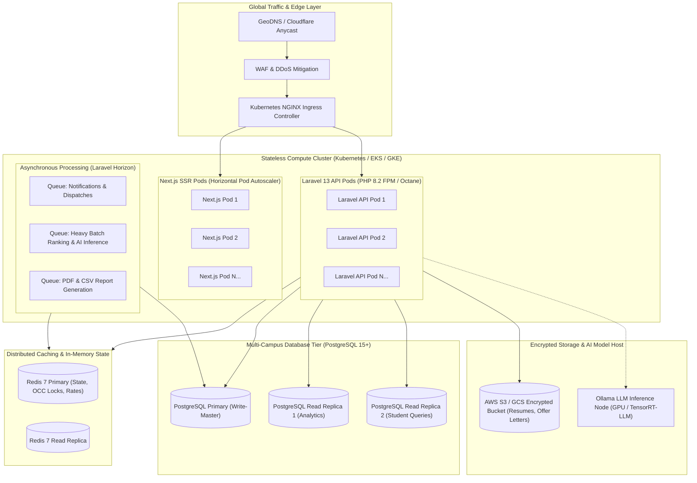

# CAMPUSLINK Multi-Campus Scalability & Deployment Approach

## 1. Multi-Campus Architecture & Tenancy Strategy

CAMPUSLINK is architected to support university systems, educational consortiums, and multi-campus institutions (e.g., State University Systems with 10+ satellite campuses and 50,000+ students).



---

## 2. Multi-Tenancy Data Isolation Model

For multi-campus deployments, CAMPUSLINK implements a **Discriminator-Based Hybrid Multi-Tenant Strategy**:

### 2.1 Schema & Row-Level Tenant Scoping (`campus_id`)
* All core relational tables (`students`, `placement_drives`, `offers`, `venues`, `institutional_events`) include an indexed `campus_id` foreign key.
* **Global Eloquent Scope**: A tenant scope (`CampusScope`) automatically restricts all Eloquent queries to the user's authorized campus context:
  ```php
  static::addGlobalScope('campus', function (Builder $builder) {
      if ($campusId = auth()->user()?->campus_id) {
          $builder->where('campus_id', $campusId);
      }
  });
  ```
* **Super-Admin Cross-Campus Aggregation**: High-level university chancellors and system deans can bypass the scope (`withoutGlobalScope('campus')`) to view system-wide placement analytics across all campuses.

### 2.2 Data Isolation Comparison

| Model | Implementation | Strengths | Trade-Offs |
| :--- | :--- | :--- | :--- |
| **Row-Level Discriminator (`campus_id`)** *(Active)* | Shared schema with indexed `campus_id` and global Eloquent scopes | Effortless cross-campus reporting, shared corporate accounts, low infrastructure cost | Requires strict automated testing to prevent tenant bleed |
| **PostgreSQL Schema-per-Campus** | Dedicated Postgres schema per campus (`campus_01`, `campus_02`) | Complete logical boundary, tenant-specific migrations | Complex cross-campus queries, higher migration overhead |
| **Database-per-Campus** | Completely isolated DB instances | Maximum regulatory isolation | Substantial operational overhead, no cross-campus drives |

---

## 3. High-Availability Horizontal Auto-Scaling Topology

### 3.1 Kubernetes Horizontal Pod Autoscaler (HPA) Policy
* **Frontend (Next.js)**: Scaled based on HTTP request rate and CPU utilization:
  * Min replicas: $3$, Max replicas: $20$, Target CPU: $70\%$.
* **Backend API (Laravel)**: Scaled based on request latency and memory:
  * Min replicas: $4$, Max replicas: $30$, Target CPU: $65\%$.
* **Queue Workers (Laravel Horizon)**: Scaled dynamically based on queue depth:
  * Scale-up threshold: $\ge 100$ pending shortlisting or notification jobs in queue.

### 3.2 Database Read/Write Splitting
* **Primary DB (Write-Master)**: Handles transactions, offer verification claims, venue reservations, and OCC state updates.
* **Read-Replicas**: Serves high-volume read endpoints:
  * Replica 1: Institutional analytics, conversion rates, and dashboard telemetry.
  * Replica 2: Student profile views and job browsing.
  * Configured natively via Laravel `database.php` read/write connection arrays.

---

## 4. Caching & Invalidation Architecture

To achieve sub-millisecond response times across thousands of simultaneous candidate lookups, Redis 7 is deployed with tag-based caching:

```
REDIS CACHE ARCHITECTURE:
  Key: "campus:{id}:readiness:{student_id}"     TTL: 24 Hours (Invalidated on academic/skill update)
  Key: "campus:{id}:venues:available:{date}"     TTL: 15 Minutes (Invalidated on round booking)
  Key: "campus:{id}:branch_canonical_map"        TTL: 7 Days (Static memory cache)
  Key: "claim:offer:{id}"                        TTL: 15 Minutes (Atomic lease token)
```

---

## 5. Disaster Recovery, Backups & Compliance

### 5.1 Recovery Objectives
* **Recovery Point Objective (RPO)**: $< 5\text{ minutes}$ (Continuous PostgreSQL WAL archiving to multi-region cloud object storage).
* **Recovery Time Objective (RTO)**: $< 15\text{ minutes}$ (Automated container recovery via Kubernetes Helm charts and automated database failover).

### 5.2 Regulatory & Candidate Privacy Compliance
* **FERPA / Academic Data Privacy**: Strict access control prevents unauthorized faculty or recruiter access to non-whitelisted student identifiers or unapproved contact details.
* **Candidate Consent & Document Cryptography**: Every candidate resume and offer document generates an immutable SHA-256 fingerprint upon upload, guaranteeing tamper-proof audit trails.
* **Role-Based Access Control (RBAC)**: Enforced through `role:STUDENT`, `role:RECRUITER`, `role:PLACEMENT_OFFICER`, and `role:SUPER_ADMIN` Sanctum middleware guards.

---

## 6. Docker & Containerized Deployment Quickstart

Production deployment is encapsulated in the official multi-container stack:

```bash
# 1. Clone repository and setup environment
cp .env.production.example .env

# 2. Build and launch infrastructure containers
docker-compose -f docker-compose.prod.yml up -d --build

# 3. Run database migrations and seeders
docker-compose exec backend php artisan migrate --force
docker-compose exec backend php artisan db:seed --force

# 4. Verify system telemetry
curl -I https://campuslink.your-institution.edu/api/v1/health
```
